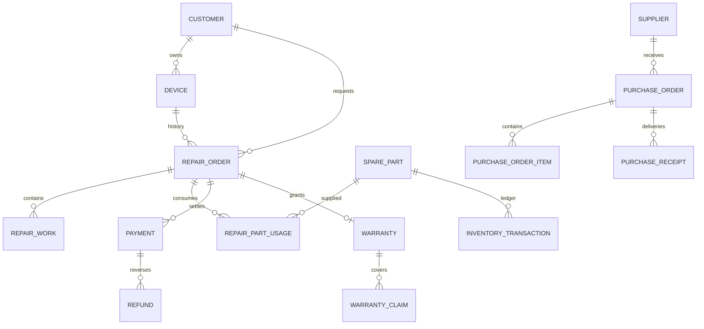

# Схема и инварианты PostgreSQL

Миграции V1–V6 — единственный источник структуры. Hibernate работает с `validate`,
Flyway `clean` отключён. База PostgreSQL 18, UTF-8; время событий `timestamptz`,
гарантийные даты `date`, суммы `numeric(19,2)`, количества `numeric(12,3)`, UUID PK.
Номера заказов, закупок и гарантий выдаются отдельными последовательностями.

| Область | Таблицы и связи |
| --- | --- |
| Доступ | app_user; spring_session → spring_session_attributes |
| Приём | customer → device; repair_order → customer, device, app_user |
| Ремонт | repair_status_history, diagnostic_record, repair_work, repair_approval → repair_order |
| Склад | supplier → spare_part; repair_part_usage → repair_order, spare_part; inventory_transaction → spare_part, usage, order, actor |
| Закупки | purchase_order → supplier; purchase_order_item → purchase_order, spare_part; purchase_receipt → purchase_order; purchase_receipt_item → receipt, item, inventory_transaction |
| Деньги | payment → repair_order; refund → payment; order_price_adjustment → repair_order; expense → order/purchase при наличии |
| Гарантии | warranty → repair_order; warranty_claim → warranty, followup_order; repair_order.source_warranty_id → warranty |
| Поддержка | notification → recipient/order; audit_log → actor; public_tracking_token → repair_order; shop_settings; idempotency_record; seed_run; application_metadata |

Остаток и стоимость материала меняются вместе с записью движения в одной транзакции.
Складской документ не редактирует остатки обычным PUT. Средневзвешенная себестоимость
фиксируется в использовании; возврат связан с исходным использованием. Закупочная
строка содержит заказанное количество, поступления — отдельные факты по этой строке.

Заказ и материал блокируются `FOR UPDATE` в установленном порядке; состояние заказа
проверяется после получения блокировки. Изменения карточек проверяют `version` и
возвращают 409 при конфликте. Команды с `Idempotency-Key` используют транзакционную
advisory-блокировку и сохраняют результат вместе с операцией.

Платежи, возвраты, движения и история не удаляются пользовательскими командами.
Клиенты, материалы, поставщики и сотрудники архивируются/деактивируются. Заказ с
операциями нельзя удалить. Внешние ключи сохраняют связи с архивными объектами.

Основные индексы покрывают номера, владельца устройства, статусы/мастера/сроки
заказов, историю по заказу и времени, движения по материалу и времени, получателя
уведомлений, дату аудита и нормализованный телефон/email клиента. Поиск с ведущим
`%` рассчитан на объём одной мастерской; отдельного поискового сервера нет.
